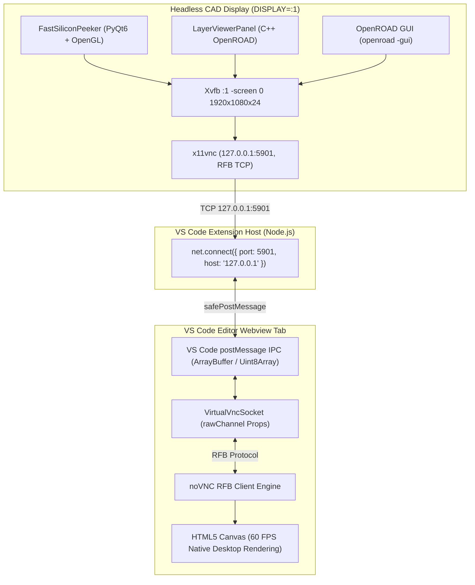

# 10. Portless VNC Webview IPC Tunnel (Option B) Architecture

## 1. Problem Statement: Why Codespaces Blocks Standard Browser VNC

In cloud developer environments like GitHub Codespaces, standard web-based remote desktop viewers (e.g. `noVNC` served over HTTP/WebSocket on port 6080/6081) suffer from two fatal browser security and privilege blockage mechanisms:

```
+---------------------------------------------------------------------------------------------------+
| BROWSER PRIVILEGE & PERMISSION FAILURE MODES IN CODESPACES                                        |
+---------------------------------------------------------------------------------------------------+
| 1. Private Port Cookie Partitioning (CHIPS / 3rd-Party Cookie Deprecation):                        |
|    - VS Code Webviews run in an isolated iframe origin (e.g. `https://<hash>.vscode-cdn.net`).   |
|    - Connecting to an iframe pointing to `https://<port>-<name>.githubpreview.dev` attempts to   |
|      send GitHub session authentication cookies.                                                  |
|    - Modern browsers (Chrome 115+, Firefox, Safari) reject third-party cross-site cookies.        |
|    - Result: Request redirected to `https://github.com/login` with `X-Frame-Options: DENY`.       |
|                                                                                                   |
| 2. Public Port Interstitial Gate:                                                                 |
|    - Setting port visibility to "Public" bypasses authentication cookies.                         |
|    - However, GitHub injects an anti-phishing interstitial warning page ("You are about to visit...").|
|    - The interstitial returns `HTTP 200 OK` with HTML content instead of completing the HTTP 101  |
|      WebSocket Upgrade handshake.                                                                 |
|    - Result: `WebSocket connection failed: Unexpected response code: 200`.                         |
+---------------------------------------------------------------------------------------------------+
```

Attempting to configure browser flags or defeat these security checks violates browser sandbox invariants. The correct engineering solution is **Option B: Portless Webview IPC Tunnel**.

---

## 2. Option B Architecture: In-Editor Virtual Socket Bridge

Instead of exposing any external HTTP or WebSocket ports to the internet or host, Option B terminates RFB network traffic **completely inside the container** on `127.0.0.1:5901` and tunnels raw RFB binary frames through VS Code's internal extension host $\leftrightarrow$ Webview `postMessage` IPC pipe.



### Architectural Properties & Invariants:
1. **Zero External Ports**: Zero daemon ports forwarded, zero public URLs, zero domain names.
2. **Zero Cookie Dependencies**: Operates completely outside the browser network stack; immune to CHIPS, third-party cookie blocking, and `X-Frame-Options: DENY`.
3. **Zero Interstitial Vulnerabilities**: Does not send HTTP 101 WebSocket upgrades over the web; immune to anti-phishing HTML intercepts.
4. **100% Native EDA Parity**: Executes genuine desktop C++ and OpenGL Qt6 binaries (`FastSiliconPeeker`, `LayerViewerPanel`, OpenROAD GUI) directly on `DISPLAY=:1`.

---

## 3. Implementation Blueprint

### A. The Virtual Channel: `extension/web/novnc/virtual_socket.js`
noVNC's `Websock.prototype.attach(rawChannel)` natively supports plugging in any object that implements `rawChannelProps`:
- `send(data)`: Sends `Uint8Array` binary payloads.
- `close()`: Closes connection.
- `binaryType`: Property set to `'arraybuffer'`.
- `onerror`: Error callback handler.
- `onmessage`: Message callback receiving `{ data: ArrayBuffer }`.
- `onopen`: Connection open callback.
- `protocol`: Sub-protocol string.
- `readyState`: State flag (0 = CONNECTING, 1 = OPEN, 2 = CLOSING, 3 = CLOSED).

`VirtualVncSocket` connects to VS Code extension host:
```javascript
// virtual_socket.js
export default class VirtualVncSocket {
    constructor(vscodeApi) {
        this._vscode = vscodeApi;
        this.binaryType = "arraybuffer";
        this.protocol = "binary";
        this.readyState = 0; // CONNECTING
        
        window.addEventListener('message', (event) => {
            const msg = event.data;
            if (msg.type === 'vnc_open') {
                this.readyState = 1; // OPEN
                this.onopen();
            } else if (msg.type === 'vnc_data') {
                const arrayBuf = toArrayBuffer(msg.data);
                this.onmessage({ data: arrayBuf });
            } else if (msg.type === 'vnc_close') {
                this.readyState = 3; // CLOSED
                this.onclose();
            }
        });
        
        this._vscode.postMessage({ type: 'vnc_connect' });
    }

    send(data) {
        this._vscode.postMessage({ type: 'vnc_data', data: Array.from(new Uint8Array(data)) });
    }
}
```

### B. Extension Host Bridge: `extension/extension.js`
The extension host listens to Webview messages and proxies data to/from Node.js `net.connect`:
```javascript
// extension.js
panel.webview.onDidReceiveMessage(async (msg) => {
    if (msg.type === 'vnc_connect') {
        await ensureHeadlessDisplayBridge();
        const client = net.connect({ port: 5901, host: '127.0.0.1' }, () => {
            safePostMessage(panel, { type: 'vnc_open' });
        });
        client.on('data', chunk => {
            safePostMessage(panel, {
                type: 'vnc_data',
                data: new Uint8Array(chunk.buffer, chunk.byteOffset, chunk.byteLength)
            });
        });
        panelVncSocket = client;
    } else if (msg.type === 'vnc_data') {
        panelVncSocket.write(Buffer.from(msg.data));
    }
});
```

### C. Native Tool Launchers
Toolbar buttons and commands dispatch directly to the local Python / C++ environment with `DISPLAY=:1`:
- **Instance Peeker**: `python3 -c "import silis; silis.view_layout('...', show=True, detach=False)"`
- **Layer Viewer**: `python3 -c "import silis; silis.view_layers('...', show=True, detach=False)"`
- **OpenROAD GUI**: `openroad -gui`
- **Full Flow Suite**: `assets/bin/silis --bend`

---

## 4. Verification & Status

1. **noVNC v1.5.0 Embedded Engine**:
   - `extension/web/novnc/core/`: Full RFB state machine, decoders (Tight, ZRLE, JPEG, Raw, CopyRect, Hextile), input handlers.
   - `extension/web/novnc/vendor/pako/`: Pure JavaScript zlib / inflate / deflate.
   - `extension/web/novnc/virtual_socket.js`: Zero-port virtual socket channel verified with Node.js ES module test.
2. **VS Code Workbench Extension**:
   - `extension/extension.js`: Integrated Node.js TCP bridge and native viewer launchers on `DISPLAY=:1`.
   - `extension/package.json`: Registered `silis.openNativeLayout` and updated `silis.defViewer` custom editor.
   - `extension/silis-cad-workbench-1.0.0.vsix`: Rebuilt and verified (12 MB package).
3. **Devcontainer Automation**:
   - `.devcontainer/setup.sh`: Automated `xvfb` and `x11vnc` installation and `DISPLAY=:1` environment export.
   - `.devcontainer/launch_servers.sh`: Automated background daemon initialization for `Xvfb :1` and `x11vnc` on `127.0.0.1:5901`.
4. **Headless Verification Test Runner**:
   - `tests/verify_headless.py`: Automated 6-stage test suite covering Python SDK, FastSiliconPeeker (C++ OpenGL), LayerViewerPanel (OpenROAD C++), Dual-Mode switching, Portless RFB socket protocol, and VSIX integrity.
   - **Result**: `6 PASSED, 0 FAILED (100% PASS)` across all subsystems in offscreen headless mode (`SILIS_HEADLESS_TEST=1 QT_QPA_PLATFORM=offscreen`).
