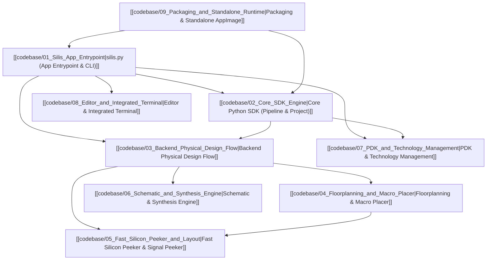

# Silis EDA Codebase Architecture & Knowledge Graph

This note is the central nexus of the interactive Obsidian Knowledge Graph for the **Silis** ASIC physical design and multi-domain power studio EDA platform.

Every subsystem node below is bidirectionally linked to visualize the complete flow of data, state mutations, and compilation stages from RTL source intake through GDSII tapeout and standalone AppImage distribution.

---

## 1. Primary Architecture Subsystem Nodes

1. **[[codebase/01_Silis_App_Entrypoint]]**: Top application driver (`silis.py`), CLI argument parser, GUI initialization (`SilisApp`, `MainWindow`), session state manager, and IPC coordination.
2. **[[codebase/02_Core_SDK_Engine]]**: Strongly typed, headless physical design SDK (`core/sdk/`) implementing `Pipeline`, `Project`, `Floorplan`, `PowerNetwork`, `TimingGraph`, and `Layout`. Adheres to [[philosophy/GUI_as_a_Projection]].
3. **[[codebase/03_Backend_Physical_Design_Flow]]**: Authoritative flow orchestration (`core/backendflow/flow/backendflow.py`), signoff runner, GDS snapshot renderer, and OpenROAD batch execution.
4. **[[codebase/04_Floorplanning_and_Macro_Placer]]**: Real-time canvas floorplanner (`core/backendflow/floorplanner/`), macro autoplacers, region fence legalizers, UPF power domain managers, and pad ring generators.
5. **[[codebase/05_Fast_Silicon_Peeker_and_Layout]]**: High-performance layout inspection (`core/backendflow/siliconpeeker/` & `core/signalpeeker/`), DEF parsers, multi-layer rendering, interactive measurement ruler, and ROHD waveform timeline integration.
6. **[[codebase/06_Schematic_and_Synthesis_Engine]]**: RTL synthesis and gate-level schematic viewer (`core/schematicviewer/` & `core/synth_engine/`), DigitalJS integration, and Yosys synthesis worker threads.
7. **[[codebase/07_PDK_and_Technology_Management]]**: Foundational semiconductor PDK profiles (`core/pdkmanagers/`), SkyWater 130nm (`sky130B`), GlobalFoundries 180nm (`gf180mcu`), and Volare package synchronization.
8. **[[codebase/08_Editor_and_Integrated_Terminal]]**: Polyglot RTL source code editing (`core/editor/`), Monaco Web tabs, Scintilla fallback, and integrated QProcess terminal (`core/terminal/`).
9. **[[codebase/09_Packaging_and_Standalone_Runtime]]**: 100% turnkey standalone Linux distribution (`packaging/`), embedded CPython 3.12 standalone, bundled wheels, system `.so` harvesting, and `AppRun` environment isolation.

---

## 2. Invariant Laws & Architectural Contracts

- [[philosophy/Physical_Design_as_Compilation]] — Hardware compilation model (RTL $\to$ AST $\to$ DEF/LEF IR $\to$ GDSII bytecode).
- [[philosophy/Zero_Catch_Law]] — Strict prohibition on silent catch blocks to prevent undetected silicon mask defects.
- [[philosophy/GUI_as_a_Projection]] — The GUI is a zero-logic presentation shell projecting authoritative SDK methods.
- [[decisions/AppImage_Host_Dependency_Defect_Penalty]] — Strict zero-host-dependency invariant for standalone AppImage execution.
- [[decisions/Authoritative_SDK_State]] — SDK as single source of truth for 100% bug reproducibility without Qt.
