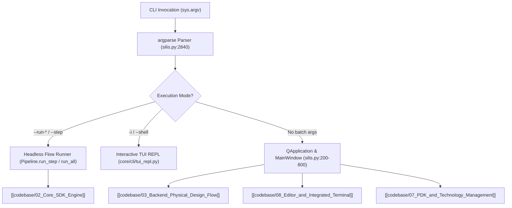

# Silis App Entrypoint & CLI Subsystem

File: [`silis.py`](file:///home/econsystems/silisfoundation/silis/silis.py)

The top-level application root for Silis orchestrates both headless CLI invocations and the full Qt6 IDE desktop application.

## Key Classes & Entrypoints
- `class MainWindow(QMainWindow)`: Primary application window hosting tabs for Editor, Synthesis, Floorplanner, SiliconPeeker, Backend PnR, Terminal, and Volare.
- `class SilisLauncher(QDialog)`: Interactive startup wizard and recent project selector.
- `def main()`: CLI parser evaluating `--init`, `--rtl`, `--tb`, `--sdc`, `--pdk`, `--top`, `--run-all`, `--run-floorplan`, `--run-pdn`, `--run-route`, and `--bend` (standalone backend mode).

## Connected Graph Nodes
- Upstream: [[codebase/00_Codebase_Graph]]
- Runtime Bundle: [[codebase/09_Packaging_and_Standalone_Runtime]]
- Engine Driver: [[codebase/02_Core_SDK_Engine]]
- Flow Controller: [[codebase/03_Backend_Physical_Design_Flow]]
