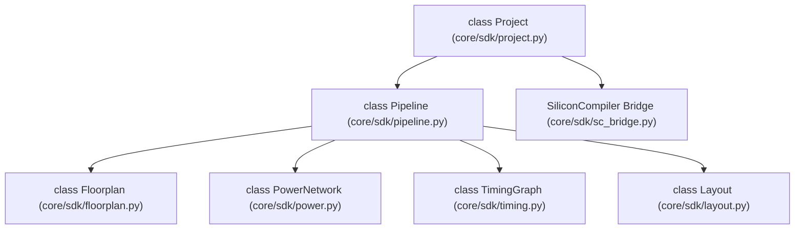

# Core SDK Engine Subsystem

Directory: [`silis/core/sdk/`](file:///home/econsystems/silisfoundation/silis/core/sdk/)

The Silis Python SDK is the single source of truth for all physical design calculations, DRC legalizations, and OpenROAD script generation.

## Fundamental Objects
- `class Project`: Represents an on-disk ASIC project containing `.silisproj` configuration, RTL sources, constraints, power intent, and build artifacts.
- `class Pipeline`: Programmatic flow controller providing methods for `synthesis()`, `init()`, `floorplan()`, `tapcells()`, `pdn()`, `iopins()`, `place()`, `cts()`, `route()`, `fill()`, `gds()`, and `signoff()`.
- `class Floorplan`: Die boundary, core area, macro instances, halo keepouts, and standard cell site row snapping ($y = k \cdot 2.72\ \mu\text{m}$).
- `class PowerNetwork`: UPF 3.0 power domains, isolation rules, level shifters, and power switch sizing calculations.
- `class Layout`: Geometric layout representations with OpenDB read-only query caching.

## Invariant Guarantees
- Zero GUI-SDK deviance: The GUI must never implement custom physical design algorithms; it delegates directly to SDK methods.
- 100% testable without Qt: Any pipeline failure can be reproduced in a standalone Python script.

## Connected Graph Nodes
- Root: [[codebase/00_Codebase_Graph]]
- Called by: [[codebase/01_Silis_App_Entrypoint]]
- Implemented by: [[codebase/03_Backend_Physical_Design_Flow]]
- Floorplan Physics: [[codebase/04_Floorplanning_and_Macro_Placer]]
