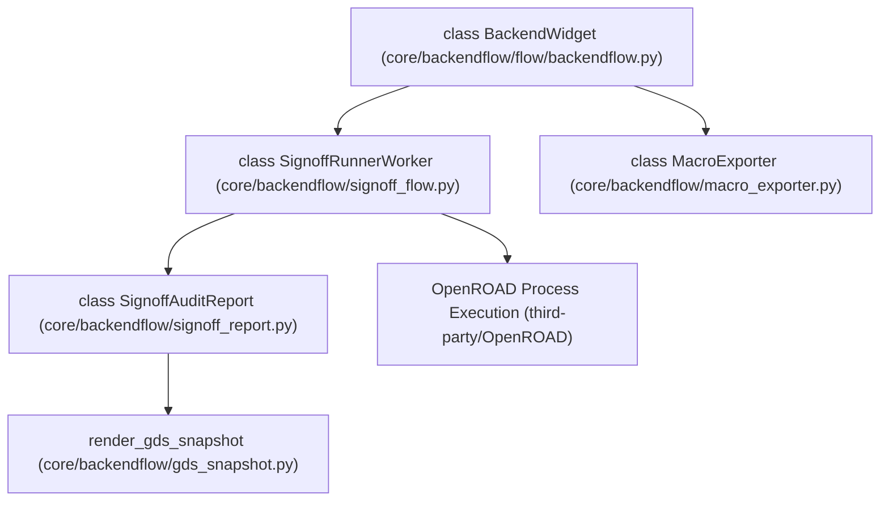

# Backend Physical Design Flow Subsystem

Directory: [`silis/core/backendflow/`](file:///home/econsystems/silisfoundation/silis/core/backendflow/)

The Backend Physical Design Flow is the orchestration layer that translates user floorplans and power intent into concrete OpenROAD physical implementation runs and generates sign-off verification reports.

## Critical Modules & Defect History
- `flow/backendflow.py`: Main backend GUI tab hosting step execution buttons, log streaming, and report inspection.
- `signoff_flow.py`: Dispatches DRC, LVS, STA, Antenna, and Tapeout checks.
- `signoff_report.py`: Assembles markdown and HTML signoff audit reports with embedded layout thumbnails.
- `gds_snapshot.py`: Renders GDSII cell geometry into high-resolution PNG snapshots using `gdstk` and `PIL` (Pillow).
  > [!IMPORTANT]
  > **Dependency Invariant**: `gds_snapshot.py` requires `PIL.Image` and `PIL.ImageDraw`. Missing `Pillow` in bundled AppImage environments causes fatal `ModuleNotFoundError`.
- `macro_exporter.py`: Packages hardened IP blocks with LEF, LIB, GDS, and Verilog stubs for IP reuse.

## Connected Graph Nodes
- Root: [[codebase/00_Codebase_Graph]]
- Invoked from: [[codebase/01_Silis_App_Entrypoint]]
- SDK Mapping: [[codebase/02_Core_SDK_Engine]]
- Floorplan Studio: [[codebase/04_Floorplanning_and_Macro_Placer]]
- Layout Viewer: [[codebase/05_Fast_Silicon_Peeker_and_Layout]]
- AppImage Packaging: [[codebase/09_Packaging_and_Standalone_Runtime]]
