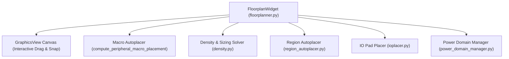

# Floorplanning & Macro Placer Subsystem

Directory: [`silis/core/backendflow/floorplanner/`](file:///home/econsystems/silisfoundation/silis/core/backendflow/floorplanner/)

This subsystem provides the real-time interactive 2D floorplanning canvas, multi-voltage UPF island creation, macro placement algorithms, and peripheral I/O pad assignment.

## Algorithmic Capabilities
- **Peripheral Macro Placement**: Sweeps 4 priority corners (Bottom-Left, Bottom-Right, Top-Left, Top-Right) followed by core boundaries with site-row snapping ($y = k \cdot 2.72\ \mu\text{m}$).
- **Minimum Die for Pads Solver**: Evaluates aspect ratios ($0.5$ to $2.0$) and computes whether the design is `CORE-LIMITED` or `PAD-LIMITED`.
- **Power Domain Fences**: Enforces strict spatial isolation (`create_voltage_fence`) for IEEE 1801 UPF 3.0 power islands.
- **Order-Preserving Pad Spacing**: Spaces pad cells along die edges while strictly maintaining port sequence from `pin_order.cfg`.

## Connected Graph Nodes
- Root: [[codebase/00_Codebase_Graph]]
- Backend Orchestrator: [[codebase/03_Backend_Physical_Design_Flow]]
- Geometric Verification: [[codebase/02_Core_SDK_Engine]]
- Layout Rendering: [[codebase/05_Fast_Silicon_Peeker_and_Layout]]
