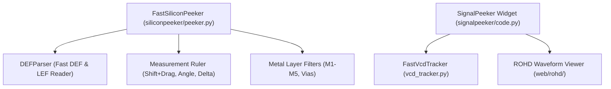

# Fast Silicon Peeker & Signal Peeker Subsystem

Directories:
- [`silis/core/backendflow/siliconpeeker/`](file:///home/econsystems/silisfoundation/silis/core/backendflow/siliconpeeker/)
- [`silis/core/signalpeeker/`](file:///home/econsystems/silisfoundation/silis/core/signalpeeker/)

This subsystem delivers zero-latency 2D DEF layout visualization and interactive VCD waveform tracking with bi-directional cross-probing.

## Features
- **High-Performance DEF Rendering**: Supports layouts up to 500k standard cells with viewport clipping and level-of-detail culling.
- **Flightlines & Routing Corridors**: Renders elastic Bézier flylines between connected macro pins and perimeter pads.
- **VCD Waveform Timeline Scrubbing**: Fast native parsing of VCD/FST dumps with timestamp seeking and Monaco wire annotation.

## Connected Graph Nodes
- Root: [[codebase/00_Codebase_Graph]]
- Floorplan Layout: [[codebase/04_Floorplanning_and_Macro_Placer]]
- Backend Signoff: [[codebase/03_Backend_Physical_Design_Flow]]
- Editor Integration: [[codebase/08_Editor_and_Integrated_Terminal]]
