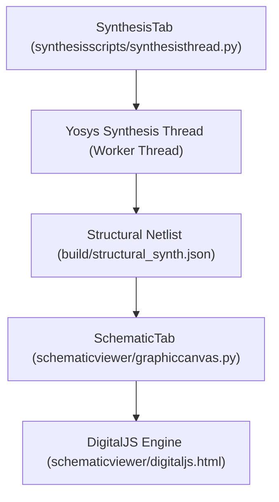

# Schematic & Synthesis Engine Subsystem

Directories:
- [`silis/core/schematicviewer/`](file:///home/econsystems/silisfoundation/silis/core/schematicviewer/)
- [`silis/core/synthesisscripts/`](file:///home/econsystems/silisfoundation/silis/core/synthesisscripts/)
- [`silis/core/synth_engine/`](file:///home/econsystems/silisfoundation/silis/core/synth_engine/)

Provides automated RTL synthesis invocation via Yosys and visual gate-level schematic netlist inspection.

## Features
- **Asynchronous Synthesis**: Background QThread execution with live log parsing for logic cell counts and critical paths.
- **Interactive DigitalJS Canvas**: Hierarchical subcircuit descent, pin probing, and live value updates driven by waveform cursor positions.

## Connected Graph Nodes
- Root: [[codebase/00_Codebase_Graph]]
- Invoked by: [[codebase/01_Silis_App_Entrypoint]]
- Waveform Cross-probing: [[codebase/05_Fast_Silicon_Peeker_and_Layout]]
- Backend Input: [[codebase/03_Backend_Physical_Design_Flow]]
