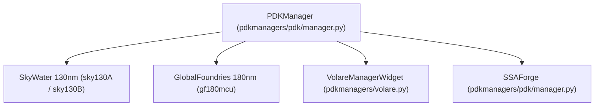

# PDK & Technology Management Subsystem

Directory: [`silis/core/pdkmanagers/`](file:///home/econsystems/silisfoundation/silis/core/pdkmanagers/)

Manages open-source semiconductor Process Design Kits (PDKs), cell libraries, techlefs, and versioning via Volare.

## Features
- **Auto-Provisioning**: Unpacks embedded minimal standard cell LEF/techlef/lib from AppDir assets on first boot (`~/.silis/pdks/`).
- **DRC Rules & Profiles**: Invariant site heights (`unithd` = 2.72 µm) and layer definitions (`li1` through `met5`).

## Connected Graph Nodes
- Root: [[codebase/00_Codebase_Graph]]
- Floorplan Physics: [[codebase/04_Floorplanning_and_Macro_Placer]]
- SDK Tech Reference: [[codebase/02_Core_SDK_Engine]]
- AppImage Bundling: [[codebase/09_Packaging_and_Standalone_Runtime]]
