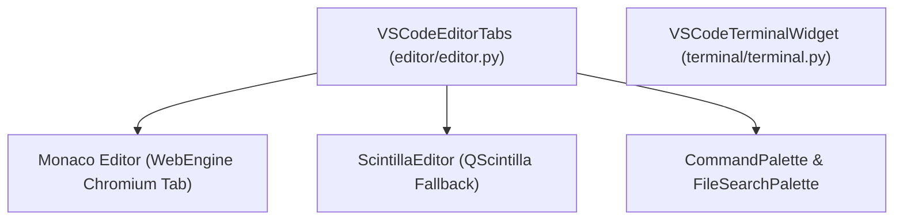

# Editor & Integrated Terminal Subsystem

Directories:
- [`silis/core/editor/`](file:///home/econsystems/silisfoundation/silis/core/editor/)
- [`silis/core/terminal/`](file:///home/econsystems/silisfoundation/silis/core/terminal/)

Provides code authoring, command palettes, file search, and an integrated EDA command shell.

## Features
- **Polyglot RTL Highlighting**: SystemVerilog, VHDL, SDC, UPF, and OpenROAD TCL syntax coloring.
- **Embedded Terminal**: Intercepts stdout/stderr from bash, OpenROAD, and Yosys subprocesses.

## Connected Graph Nodes
- Root: [[codebase/00_Codebase_Graph]]
- App Window: [[codebase/01_Silis_App_Entrypoint]]
- Waveform Values Annotation: [[codebase/05_Fast_Silicon_Peeker_and_Layout]]
