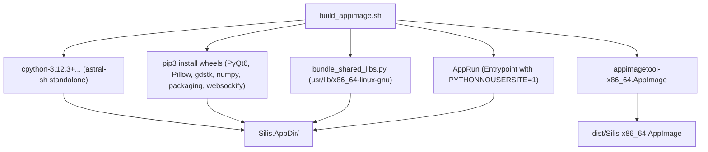

# Packaging & Standalone AppImage Runtime

Directory: [`silis/packaging/`](file:///home/econsystems/silisfoundation/silis/packaging/)

Builds the turnkey standalone Linux distribution (`dist/Silis-x86_64.AppImage`) bundling embedded CPython 3.12, all Python wheels, external system `.so` libraries, and OpenROAD/Yosys binaries.

## Critical Packaging Requirements & Invariant Laws
1. **Mandatory `PYTHONNOUSERSITE=1`**:
   `AppRun` must explicitly export `PYTHONNOUSERSITE=1` to guarantee complete isolation from host site-packages. Without this, missing packages on clean workstations trigger fatal runtime crashes.
2. **Complete Wheel Inventory**:
   All dependencies imported across the codebase must be pre-installed into `AppDir/opt/python/lib/python3.12/site-packages`:
   - `PyQt6`, `PyQt6-WebEngine`, `PyQt6-QScintilla`
   - `Pillow` (PIL) — required by `core/backendflow/gds_snapshot.py`
   - `packaging` — required by `core/updater/delta_updater.py`
   - `gdstk` — required by GDS snapshot and 3D viewers
   - `numpy` — required by floorplanner and peeker
   - `websockify` — required by noVNC bridge
3. **Shared Library Harvesting & Transitive Closure**:
   `bundle_shared_libs.py` inspects all binary ELF and `.so` objects across `opt/python`, `third-party/bin`, `core`, and `third-party/GDS3D` using `ldd` and recursively computes the transitive closure of all external dependencies, copying them into `AppDir/usr/lib/x86_64-linux-gnu/`.
   Key bundled libraries:
   - `libicudata.so.74`, `libicui18n.so.74`, `libicuuc.so.74` (OpenROAD ICU dependency)
   - `libtcl8.6.so`, `libtclreadline-2.3.8.so` (OpenSTA, Yosys, and SynthEngine)
   - `libreadline.so.8`, `libtinfo.so.6` (CLI REPL and EDA toolchains)
   - `libOpenGL.so.0`, `libgomp.so.1` (GDS3D OpenMP and OpenGL acceleration)
   - `libdouble-conversion.so.3`, `libmd4c.so.0`, `libpcre2-16.so.0` (OpenROAD runtime)
4. **Relative Symlink Portability**:
   All symlinks within `AppDir` (`sta`, `monaco/min/vs`, `core/editor/vs`) must be normalized to relative paths so they never leak host user paths (`/home/...`).
5. **Accurate QtWebEngine Discovery**:
   `AppRun` discovers `QtWebEngineProcess`, resources, and translation locales under `$PY_SITE/PyQt6/Qt6/` to ensure full webview compatibility.

## Connected Graph Nodes
- Root: [[codebase/00_Codebase_Graph]]
- Packaging Policy: [[decisions/AppImage_Host_Dependency_Defect_Penalty]]
- Application Entrypoint: [[codebase/01_Silis_App_Entrypoint]]
- GDS Snapshot Dependency: [[codebase/03_Backend_Physical_Design_Flow]]
