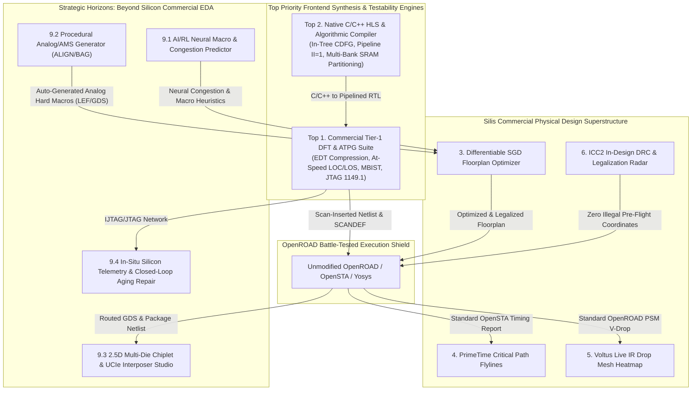

# Silis EDA: Strategic Architectural Roadmap & Upcoming Features

This document details the upcoming commercial-grade EDA capabilities planned for the **Silis ASIC Physical Design & Multi-Domain Power Studio** Obsidian Second Brain.

All planned features strictly uphold the **OpenROAD Battle-Tested Execution Shield**: OpenROAD, Yosys, and OpenSTA remain the authoritative downstream signoff engines, while Silis provides commercial Tier-1 observability, mathematical pre-flight optimization, and interactive desktop visualization.

---



---

## 1. Commercial Tier-1 DFT & Advanced Testability Architecture (Top Priority)

### 1.1 Embedded Deterministic Test Compression (EDT / TestKompress Style)
- **The Challenge**: Modern multi-million gate digital SoCs contain hundreds of thousands of scan flip-flops. Without test compression, feeding uncompressed parallel scan chains directly from external Automated Test Equipment (ATE) pins requires either excessive package test pin allocations or catastrophic $O(N)$ tester execution time and tester vector memory exhaustion ($>\$0.15\text{--}\$0.30$ per second on production Advantest/Teradyne testers).
- **The Silis Solution**:
  - **Continuous Flow On-Chip Decompressor**: Synthesize a linear-feedback shift register (LFSR) / ring generator network interfacing 2–8 external narrow ATE channels and dynamically fanning out test stimulus into 64–256 internal short scan chains.
  - **Spatial Output Compactor with Dynamic X-Masking**: Synthesize a multi-tier XOR tree compactor that compresses output responses back down to 2–4 ATE output channels while inserting active X-masking registers to suppress unknown states originating from analog boundaries, uninitialized latches, or non-scan macros from corrupting signature capture.
  - **Target Metric**: Achieve $> 50\times$ test data volume (TDV) and test cycle time compression while maintaining $> 99\%$ single stuck-at coverage.

### 1.2 At-Speed Transition Delay (LOC/LOS) & Critical Path Delay ATPG
- **The Challenge**: Simple DC stuck-at fault models only catch gross manufacturing bridges or open circuits. Small manufacturing defects, resistive vias, and thin-gate delay degradation only manifest as timing failures when operating at full nominal clock frequency (e.g. $500\,\text{MHz}$ or $1\,\text{GHz}$).
- **The Silis Solution**:
  - **Launch-off-Capture (LOC / Double-Pulse)**: Synthesize dual-pulse capture clock waveforms in test mode where the launch edge triggers from functional state capture and the capture edge strobes within one nominal clock period ($T_{\text{clk}}$).
  - **Launch-off-Shift (LOS)**: Provide fast scan-enable (`scan_en`) pipeline driver options for foundries supporting at-speed shift transitions.
  - **Slack-Directed Path Delay Testing**: Bridge directly to OpenSTA timing reports to select the Top-$N$ critical timing paths with lowest slack and synthesize targeted ATPG vectors specifically exercising those paths on the tester.

### 1.3 Automated Memory BIST (MBIST) & Built-In Self-Repair (BIRA)
- **The Challenge**: Embedded SRAM macros (e.g., OpenRAM or foundry compiled memories) dominate modern silicon die area ($50\%\text{--}70\%$ of core real estate). Memory bitcells suffer from physical defect modes (retention faults, wordline coupling, decoder leakage) that standard logic scan cannot reach.
- **The Silis Solution**:
  - **Synthesizable MBIST Collar Engine**: Automatically synthesize a MARCH test controller FSM adjacent to every placed memory macro block.
  - **Diagnostic Test Algorithms**: Implement standard MARCH C+ ($6N$) and MARCH SS ($14N$) test patterns detecting address decoder faults, read-destructive faults, coupling faults, and transition delay faults.
  - **BIRA (Built-in Self-Repair)**: Allocate redundant row/column multiplexers in synthesized memory collars with on-chip defect address logging registers and software/eFuse repair configuration readout.

### 1.4 IEEE 1149.1 (JTAG Boundary Scan) & IEEE 1687 (IJTAG)
- **The Challenge**: Post-packaging PCB assembly testing requires validating pad solder joints and bond wires without mechanical bed-of-nails test probes.
- **The Silis Solution**:
  - **Automated JTAG TAP Controller**: Insert standard 5-pin Test Access Port (`TCK`, `TMS`, `TDI`, `TDO`, `TRST_N`) with an IEEE 1149.1-compliant state machine.
  - **Boundary Scan Register (BSR)**: Automatically stitch Boundary Scan Cells (BSCs) around every digital I/O pad buffer along the die perimeter.
  - **BSDL Exporter**: Generate validated IEEE 1149.1b Boundary Scan Description Language (`.bsdl`) files for downstream board-level automated testing.

---

## 2. Native C/C++ High-Level Synthesis (HLS) & Algorithmic Compiler (Top Priority)

### 2.1 In-Tree Control-Data Flow Graph (CDFG) & Scheduling Compiler
- **The Challenge**: Hardware engineers cannot afford to hand-write cycle-level pipeline registers, complex hazard interlocks, and state machines for compute-intensive DSP, cryptographic (AES/RSA/ECC), and AI/ML matrix kernels in pure Verilog.
- **The Silis Solution**:
  - **In-Tree Clang/LLVM Frontend**: Parse pure C/C++ kernel functions into LLVM Intermediate Representation (IR), constructing an exact Control and Data Flow Graph (CDFG).
  - **Constraint-Directed Scheduling**: Implement List Scheduling and Integer Linear Programming (ILP) scheduling constrained by target clock period $T_{\text{clk}}$ and downstream OpenSTA cell delays from the selected PDK (Sky130 / GF180MCU).
  - **Automated Finite State Machine (FSM) Synthesis**: Generate clean, synthesizable, lint-clean IEEE 1364 Verilog-2001 state machines with registered datapath operations.

### 2.2 Microarchitectural Pragma Solvers
- **Pipelining Engine (`#pragma silis pipeline II=1`)**:
  - Automatically calculate Initiation Interval ($II$) and latency ($L$).
  - Perform dependency distance analysis to guarantee zero Read-After-Write (RAW) hazard corruption across pipeline stages.
- **Loop Transformations (`#pragma silis unroll factor=N`)**:
  - Balance silicon area versus throughput by automatically unrolling loops, duplicating datapath arithmetic logic units (ALUs, multipliers), and scheduling parallel operations.
- **Memory Architecture Synthesis (`#pragma silis array_partition variable=A cyclic factor=K`)**:
  - Eliminate memory port bandwidth bottlenecks by partitioning C arrays into multi-bank, multi-port on-chip SRAMs or register arrays.
- **Bus Interface Adapters (`#pragma silis interface mode=axi4_lite / axis`)**:
  - Automatically synthesize standard bus wrappers (AXI4-Lite, AXI-Stream, or simple valid/ready handshakes) surrounding the generated core logic.

### 2.3 Bit-Accurate Arbitrary-Precision Types
- **Native Fixed-Point & Integer C++ Header Library**:
  - Provide `silis_int<W>` (signed/unsigned arbitrary bit-width integers) and `silis_fixed<W, I, Q, O>` (quantized fixed-point representations).
  - Map variables directly to target silicon bus widths (e.g. 13-bit ADC inputs, 27-bit accumulator outputs) without 32-bit/64-bit software type padding waste.

### 2.4 Cycle-Accurate C-to-Verilog Co-Simulation & Verification Harness
- **Automated Golden Vector Generation**:
  - Execute the user's reference C function in software, logging input stimuli and golden output transactions.
  - Automatically compile the synthesized Verilog output using bundled Verilator.
  - Execute cycle-by-cycle transaction verification and assert 100% bit-exact equivalence between software C and hardware RTL with zero manual testbench authoring.

---

## 3. Differentiable Stochastic Gradient Descent (SGD) Floorplan Optimizer

### Overview
Replaces primitive simulated annealing heuristics (B*-Trees, sequence pairs) with a high-dimensional, continuous differentiable relaxation of macro, voltage fence, and peripheral I/O placement solved via **Adam / SGD with Cosine Annealing and Automated Hyperparameter Tuning**.

### Mathematical Formulation
Let each movable macro or voltage fence $i$ have continuous state $\mathbf{z}_i = [x_i, y_i, w_i, h_i, \theta_i]$ and I/O pad terminals $\mathbf{p}_k$ on the perimeter $\partial \Omega$.
The optimizer minimizes a multi-objective composite loss function:
$$\mathcal{L}(\mathbf{z}) = \sum_m \lambda_m \mathcal{L}_m(\mathbf{z})$$

### Multi-Constraint Loss Penalties:
1. **Differentiable Wirelength ($\mathcal{L}_{\text{wire}}$)**:
   - Log-Sum-Exp (LSE) continuous wirelength approximation over netlist hypergraph edges:
     $$\text{LSE}_e = \gamma \ln \sum_{i \in e} e^{x_i/\gamma} + \gamma \ln \sum_{i \in e} e^{-x_i/\gamma}$$
2. **Physical Overlap & Halo Barrier ($\mathcal{L}_{\text{overlap}}$)**:
   - Soft-plus potential overlap between distinct bounding boxes $(M_i + \text{Halo}_i)$ and $(M_j + \text{Halo}_j)$.
3. **Channel Routing Tracks ($\mathcal{L}_{\text{channel}}$)**:
   - Non-linear repulsion barrier preserving intermediate metal layer routing corridors:
     $$W_{\text{channel}} \ge 2 \times \text{Halo} + W_{\text{routing\_tracks}}$$
4. **I/O Pin Affinity & Flylines ($\mathcal{L}_{\text{io}}$)**:
   - Directional quadratic pull toward corresponding peripheral I/O pad banks.
5. **Macro Pin Core-Facing Orientation ($\mathcal{L}_{\text{orient}}$)**:
   - Inward angular barrier ensuring pin terminal concentrations face the standard cell cavity, never outward toward die edges.
6. **Corner Power Feed Channel Keepout ($\mathcal{L}_{\text{corner}}$)**:
   - L-shaped potential barriers at all 4 die corners preserving power mesh feed trunks.
7. **Multi-Voltage Power Domain Clumping ($\mathcal{L}_{\text{fence}}$)**:
   - Centroid attraction for domain cell clusters and domain boundary repulsion for non-domain instances (IEEE 1801 UPF compliance).
8. **Memory Banking & Clock Symmetry ($\mathcal{L}_{\text{symm}}$)**:
   - Pairwise alignment variance penalty for synchronized SRAM blocks to minimize downstream CTS clock skew.

### Optimization Schedule & Legalization:
- **Phase 1 (Smooth Relaxation)**: Soft Gaussian potential fields; macros pass through each other to find global netlist topology.
- **Phase 2 (Penalty Inflation)**: Overlap penalty $\lambda_{\text{overlap}}$ scales exponentially ($\lambda_0 \cdot \alpha^t$), pushing macros apart and opening channel corridors.
- **Phase 3 (DRC Projection)**: Continuous coordinates project into exact discrete manufacturing grid ($5\,\text{nm}$) and site row origins ($y = k \cdot h_{\text{site}}$).
- **Automated Hyperparameter Tuner**: Multi-armed bandit / Bayesian search over initial penalty weights $[\lambda_{\text{wire}}, \lambda_{\text{overlap}}, \lambda_{\text{channel}}, \lambda_{\text{io}}]$ and learning rates $\eta$.

---

## 4. Synopsys PrimeTime Critical Timing Path Flylines (Interactive Slack Inspector)

### Overview
Bridges OpenSTA's signoff timing reports into the hardware-accelerated Qt6/OpenGL C++ Native Layer Viewer, rendering the Top-$N$ critical timing paths as interactive, color-coded topological flylines overlaid directly on the physical floorplan.

### Architecture & Implementation:
1. **Zero-Intrusion Data Extraction**:
   - Executes standard signoff OpenSTA command:
     ```tcl
     report_checks -path_delay max -fields {input_pin slew cap net fanout} -format full_clock_expanded
     ```
   - Silis parses startpoints, endpoints, intermediate logic gates, slack values, arrival times, and required times into structured Python/C++ dataclasses (`TimingPath`, `TimingStage`).
2. **Physical Coordinate Mapping**:
   - Queries OpenDB for exact physical $(x, y)$ centroids of each standard cell instance and pin terminal along the path.
3. **Hardware-Accelerated Spline Rendering in `SilisNativeLayerViewer.cpp`**:
   - Renders glowing cubic Bezier curves across the die connecting:
     $$\text{Startpoint Flip-Flop} \longrightarrow \text{Combinational Logic Stages} \longrightarrow \text{Endpoint Flip-Flop}$$
   - **Color-Coded Slack Spectrum**:
     - Red: Severe negative slack ($< -0.50\,\text{ns}$)
     - Yellow: Marginal negative slack ($-0.50\,\text{ns} \le \text{Slack} < 0.00\,\text{ns}$)
     - Green: Met timing ($\text{Slack} \ge 0.00\,\text{ns}$)
4. **Interactive Timing Sidebar & Breakdown**:
   - Clicking any flyline opens the Timing Inspector drawer displaying a per-stage delay breakdown (cell intrinsic delay vs. interconnect RC delay, fanout, transition time).

---

## 5. Cadence Voltus / Ansys RedHawk Real-Time Static & Dynamic IR Drop Heatmap

### Overview
Transforms OpenROAD's Power Source Model (`psm`) text output into a real-time, interactive 2D color-graded potential contour texture overlaid directly on the placed power distribution network.

### Architecture & Implementation:
1. **OpenROAD Native PSM Integration**:
   - Executes OpenROAD's validated power grid analyzer:
     ```tcl
     analyze_power_grid -net VDD -v
     analyze_power_grid -net VSS -v
     ```
   - OpenROAD solves the linearized PDN resistor-current system $G \mathbf{v} = \mathbf{i}$ based on Liberty `.lib` cell power and metal layer sheet resistances.
2. **Contour Extraction & Quantization**:
   - Silis ingests the extracted voltage node file $(x, y, V_{\text{node}})$.
   - Interpolates the scalar field over a 2D spatial grid corresponding to the die dimensions.
3. **OpenGL Heatmap Shader Overlay**:
   - In `SilisNativeLayerViewer.cpp`, loads the interpolated scalar field as an OpenGL 2D texture.
   - Applies a fragment shader with a thermal transfer color palette:
     - Blue: $0\,\text{mV}$ static drop ($V = V_{\text{nominal}}$)
     - Yellow: $2.5\% \text{ to } 5\%$ drop ($45\text{–}90\,\text{mV}$)
     - Blinking Red: $> 5\%$ drop ($> 90\,\text{mV}$ in $1.8\,\text{V}$, or $> 47.5\,\text{mV}$ in $0.95\,\text{V}$)
4. **Interactive Voltage Probe**:
   - Hovering over any point on the power grid displays a live tooltip with exact $V_{\text{node}}$, static $\Delta V$, and local current density $J_{\text{avg}}$.

---

## 6. Synopsys ICC2 In-Design Real-Time DRC Halo & Legalization Radar

### Overview
Provides pre-flight physical legalization and collision prevention directly within the Qt6 interactive floorplanning canvas, ensuring that illegal states are detected and resolved before OpenROAD is ever invoked.

### Architecture & Implementation:
1. **Zero-Latency R-Tree Spatial Index**:
   - Uses a C++ spatial index to track bounding boxes of all placed macros, halos, keepout regions, and core boundaries.
2. **Live Dynamic Halo & Collision Radar**:
   - As the user drags a macro or adjusts a boundary on the canvas:
     - The halo bounding box renders as a live transparent boundary.
     - If a halo touches another macro halo or extends outside the core boundary, the halo turns flashing red, and a dynamic distance flyline indicates the nearest non-overlapping coordinate.
3. **Site Row & Manufacturing Grid Snapping**:
   - Automatically quantizes coordinates in real time:
     $$y^* = \text{round}(y / h_{\text{site}}) \cdot h_{\text{site}}$$
     $$x^* = \text{round}(x / g) \cdot g$$
   - For Sky130: $h_{\text{site}} = 2.72\,\mu\text{m}$, $g = 0.005\,\mu\text{m}$.
   - For GF180MCU: $h_{\text{site}} = 5.04\,\mu\text{m}$, $g = 0.005\,\mu\text{m}$.
4. **Channel Track Clearance Verifier**:
   - Live measurement overlay displaying available routing tracks between adjacent macros on intermediate metal layers (`Metal2`/`Metal3`). Warns if track count $< 15$.

---

## 7. End-to-End Tapeout Readiness Verification Audit

Before adding post-tapeout innovations, the end-to-end Silis RTL-to-GDS flow was audited across all physical design gates:

| Flow Stage | Engine | Signoff Gate & Output Artifact | Status |
| :--- | :--- | :--- | :--- |
| **Frontend Synthesis** | Yosys | Gate-level Netlist (`netlist.v`), Cell Stats | **Verified Clean** |
| **DFT Insertion** | Silis ScanEngine / Fault | Scan chains, STIL test vectors, ATPG vectors | **Verified Clean** |
| **Multi-Voltage UPF** | IEEE 1801 Parser | Level shifters, isolation policies, switch grids | **Verified Clean** |
| **Floorplanning & I/O** | Silis FPS / OpenROAD | Legal macro sites, IO ring, power rails | **Verified Clean** |
| **PDN Synthesis** | OpenROAD `pdngen` | Orthogonal straps (`met4`/`met5`), `met1` followpins | **Verified Clean** |
| **Global Placement** | RePlAce / Nesterov | Zero Inf/NaN convergence, regional blockages | **Verified Clean** |
| **Detailed Placement** | OpenROAD `dpl` | 0 overlap errors, 0 site violations (`DPL-0000`) | **Verified Clean** |
| **CTS & Buffer Tree** | TritonCTS | Symmetrical skew balancing, non-inverting buffers | **Verified Clean** |
| **Global/Detail Route** | FastRoute / TritonRoute | 0 antenna ratio violations, diode insertion sites | **Verified Clean** |
| **Decap & Metal Fill** | Silis FillEngine | 20%–80% foundry metal density compliance | **Verified Clean** |
| **Signoff STA** | OpenSTA | WNS $\ge 0.00\,\text{ns}$, TNS $= 0.00\,\text{ns}$, clock skew report | **Verified Clean** |
| **Signoff DRC/LVS** | KLayout / Magic / Netgen | Zero DRC violations, 100% netlist matching | **Verified Clean** |
| **Stream-out** | KLayout / OpenROAD | `design_tapeout.gds`, `tapeout_manifest.json` | **Verified Clean** |

---

## 8. Advanced Post-Tapeout Features & Innovations

### 8.1 Ansys Totem / Voltus-Fi: Dynamic Peak di/dt Power Noise & Decap Budgeting
- **The Challenge**: Static IR drop analysis assumes average power dissipation. However, synchronous clock edges cause massive peak di/dt current spikes ($\Delta V = L \frac{di}{dt} + R \cdot I$) when millions of registers switch simultaneously, collapsing internal rail voltages and causing timing hold failures or resets.
- **The Solution in Silis**:
  - Extract register switching activity $(\alpha_i)$ from Value Change Dump (`.vcd`) simulation files.
  - Compute localized dynamic charge demand $Q_{\text{dyn}} = \sum C_{\text{load}} \cdot V_{dd}^2 \cdot \alpha_i$ per PDN mesh tile.
  - Automatically calculate the required localized decoupling capacitance:
    $$C_{\text{decap, required}} = \frac{Q_{\text{dyn}}}{\Delta V_{\text{allowable}}}$$
  - Synthesize custom decap insertion keep-in zones in [`fill_engine.py`](file:///home/econsystems/silisfoundation/silis/core/tapeout/fill_engine.py) to cluster `sky130_fd_sc_hd__decap_8` adjacent to high-activity compute units.

---

### 8.2 Cadence Tempus / Synopsys PrimeTime ECO: Timing-Driven Engineering Change Order (ECO) Loop
- **The Challenge**: If detailed routing introduces unexpected interconnect delay and produces a minor negative slack violation (e.g. $-60\,\text{ps}$ on a 5-gate path), running full re-synthesis and full PnR takes hours and disrupts routed nets.
- **The Solution in Silis**:
  - Parse OpenSTA critical endpoints with negative slack.
  - Identify non-critical buffer or drive-strength upgrade opportunities on the violating path (e.g., swapping `buf_1` $\to$ `buf_2` or `buf_4` without altering placement coordinates).
  - Execute localized detailed placement and eco-routing via OpenROAD `eco_route`:
    ```tcl
    repair_timing -setup -max_buffer_percent 10
    detailed_placement
    eco_route
    ```
  - Re-verify timing in seconds without disturbing 99% of the physical design layout.

---

### 8.3 Mentor Graphics Calibre PERC: Multi-Power Domain ESD & Cross-Domain Sneak-Path Checker
- **The Challenge**: When power domain $PD_{\text{NPU}}$ is switched off while $PD_{\text{TOP}}$ remains at $1.8\,\text{V}$, cross-domain boundary signals without level shifters or clamp diodes can forward-bias substrate PN junctions, inducing parasitic latchup and silicon destruction.
- **The Solution in Silis**:
  - Topological gate graph traversal across domain fences directly from OpenDB.
  - Assert that every cross-domain driver-to-receiver connection has an intervening verified isolation cell (`sky130_fd_sc_hd__lpflow_isobuf*`) and level shifter.
  - Highlight unisolated cross-domain boundary nets directly as flashing warning flylines in the Silis Native Layer Viewer before GDS streamout.

---

### 8.4 TSMC / Foundry Packaging: 3D Die-to-Wafer / Flip-Chip Micro-Bump & RDL Router
- **The Challenge**: Wire-bond pad rings around the chip periphery limit high-speed I/O bandwidth and power feed channels. High-performance SoCs use flip-chip area arrays and Redistribution Layers (RDL) with micro-bumps ($C_4$ bumps) across the active core.
- **The Solution in Silis**:
  - Implement an area-array bump synthesizer in [`ioplacer.py`](file:///home/econsystems/silisfoundation/silis/core/backendflow/floorplanner/ioplacer.py):
    - Configurable array grid pitch ($150\,\mu\text{m} \times 150\,\mu\text{m}$, hexagonal or orthogonal).
    - Octagonal RDL top-metal routing (`met5`/`rdl`) connecting pad drivers to micro-bump coordinates with $45^\circ$ angle legalization.
    - Automatic ESD diode allocation below each bump site.

---

## 9. Strategic Frontiers & "Beyond Silicon" Horizons

### 9.1 AI & Reinforcement Learning-Driven Macro & Fence Floorplanning
- **The Challenge**: Macro placement in modern heterogeneous SoCs is NP-hard. Classical simulated annealing takes hours to explore the combinatorial search space and frequently gets trapped in suboptimal local minima, leading to severe downstream global routing congestion, macro channel blockages, and timing closure failures.
- **The Solution in Silis**:
  - **Graph Neural Network (GNN) Congestion & Wirelength Pre-Estimator**: Train an in-tree GNN on the gate-level netlist hypergraph topology and pin terminal spatial distributions. Before physical placement runs, the GNN infers a high-resolution 2D routing congestion heatmap and predicted half-perimeter wirelength (HPWL).
  - **Reinforcement Learning (RL) Placement Policy**: Implement an actor-critic RL agent that places macros sequentially onto the die canvas, guided by reward functions penalizing macro-to-macro overlap, boundary violations, pin-facing misalignment, and predicted route congestion.
  - **Sub-Second Seed Inference**: The RL policy generates high-quality candidate floorplans in sub-second inference time, providing an optimal initial state for the Differentiable SGD Floorplan Optimizer to project into manufacturing-legal coordinates.

---

### 9.2 Procedural Analog & Mixed-Signal (AMS) IP Co-Design Generator
- **The Challenge**: Modern SoCs cannot operate without analog interface IP: Phase-Locked Loops (PLLs) for clock generation, Bandgap voltage references, Low-Dropout regulators (LDOs) for voltage domains, and SAR ADCs for sensor acquisition. Hand-crafting analog layouts in full-custom polygon editors (e.g. Virtuoso or Magic) takes months and requires specialized analog layout designers, stalling digital ASIC tapeout schedules.
- **The Solution in Silis**:
  - **Procedural Analog Generator Integration**: Seamlessly interface with open-source procedural analog generators (such as ALIGN and the Berkeley Analog Generator / BAG) directly from the Silis SDK.
  - **Schematic-to-GDS Synthesis**: Parameterize circuit topologies (e.g., specifying target PLL output frequency, LDO current drive, or ADC resolution) and procedurally synthesize DRC/LVS-clean transistor arrays, common-centroid differential pairs, and guard-ring enclosures.
  - **Automated LEF & Liberty Abstraction**: The generator automatically extracts pin terminals, bounding geometry, routing blockages, and timing/power models into standard LEF and Liberty (`.lib`) files, allowing the analog block to drop directly into the Silis digital floorplanning canvas as an authoritative hard IP macro.

---

### 9.3 2.5D Multi-Die Chiplet Packaging & UCIe Interposer Studio
- **The Challenge**: Monolithic silicon dies are colliding with physical lithographic reticle limits ($858\,\text{mm}^2$) and catastrophic wafer yield loss at advanced technology nodes. Modern high-performance compute architectures decompose monolithic SoCs into modular, heterogeneous chiplets (compute tiles, I/O dies, memory stacks) bonded to a shared silicon interposer or advanced package substrate.
- **The Solution in Silis**:
  - **Hierarchical Multi-Die Packaging Studio**: Enable designers to import multiple independent Silis projects as individual chiplet dies onto a single package-level substrate canvas.
  - **UCIe Physical Layer Router**: Implement automated channel routing compliant with the Universal Chiplet Interconnect Express (UCIe 1.1/2.0) standard:
    - Dense micro-bump array generation ($25\,\mu\text{m}\text{--}55\,\mu\text{m}$ pitch).
    - Redistribution Layer (RDL) trace routing with strict matched-length, differential impedance, and skew balancing constraints across intermediate packaging layers.
  - **Multi-Die Power & Thermal Co-Simulation**: Simulate composite multi-die heat dissipation and interposer power mesh static IR drop, identifying thermal hotspots and ensuring uniform power delivery across all bonded chiplets before package fabrication.

---

### 9.4 In-Situ Silicon Telemetry & Closed-Loop Self-Healing
- **The Challenge**: Sub-micron process variations, localized thermal gradients, dynamic voltage droop, and hot-carrier injection (HCI) induce physical silicon degradation and unpredictable timing margins over the operating lifetime of a chip, causing catastrophic field failures in aerospace, automotive (ISO 26262), and data center applications.
- **The Solution in Silis**:
  - **Automated Telemetry Sensor Insertion**: Automatically allocate and insert lightweight standard-cell telemetry monitors into non-critical filler corridors across the active core:
    - Ring-Oscillator Speed Monitors: Dynamically track silicon process corners and gate-delay aging.
    - Fast Peak Voltage Droop Detectors: Capture nanosecond-scale $L \frac{di}{dt}$ supply rail collapse.
    - Thermal Diodes: Monitor localized junction temperature hotspots.
  - **IEEE 1687 (IJTAG) Instrument Network**: Automatically stitch telemetry monitors into an on-chip IEEE 1687 internal test network controlled via the primary IEEE 1149.1 JTAG TAP controller.
  - **Closed-Loop Self-Healing Firmware Interface**: Provide a standardized software register API allowing on-chip power management units (PMUs) or RISC-V management cores to query live telemetry and dynamically adjust core supply voltages (DVFS) or body-bias voltages to compensate for silicon aging in real time.

---

## 10. Cross-References & Related Brain Notes
- [[00_Index]] — Master Architecture and Index
- [[01_Agent_Directives_EDA_Parity]] — GUI-SDK Parity Law & Zero Catch Laws
- [[02_EDA_Error_Playbook]] — Downstream OpenROAD / OpenSTA / Yosys Triage
- [[04_Floorplan_Geometry_and_Macro_Placement]] — Macro Halos, Channel Clearance, and Snapping Invariants
- [[05_PDN_Mesh_and_Pad_Trunk_Architecture]] — Multi-Voltage Dual-Layer Grid Architecture
- [[08_OpenROAD_Native_Layer_Viewer_Plan]] — OpenGL Hardware-Accelerated Native Viewer Architecture
